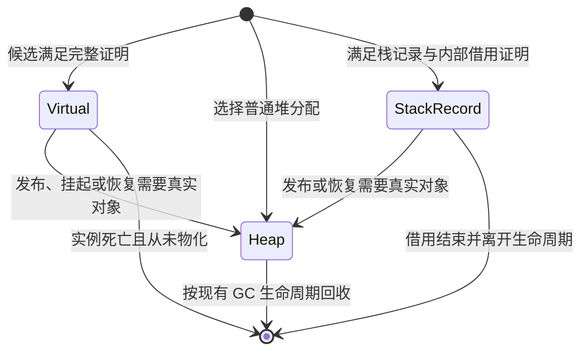

# Class 逃逸分析、分配消除与栈上存储设计

> 状态：原生后端已接通分配消除、路径物化、可重载优化帧恢复及封闭 AOT 私有栈记录。VM 与可重载 JIT 基线层继续使用普通堆实例。验证平台为 Windows x64；Linux x64 与 macOS arm64 的执行验证仍需对应平台环境。

Vela 对具体的 class 分配点进行逃逸分析，优先将局部实例拆成字段值，消除对象分配；必须拥有真实对象身份时，再物化为普通堆对象。封闭 AOT 中，经过不捕获证明的内部调用可以借用当前帧的字段槽。优化接入共享原生后端，服务封闭 AOT 和可重载 JIT；语言语法、用户 class 声明与宿主对象 ABI 保持一致。

例如：

```vela
class Point {
  x: int;
  y: int;
}

func sum(x: int, y: int): int {
  const point = Point(x: x, y: y);
  return point.x + point.y;
}
```

在证明构造与字段访问可以替换后，`point` 不需要对象头或堆地址，原生代码只需计算 `x + y`，并保留整数溢出的既有行为。字段值可以进入寄存器，也可以由 LLVM 放入普通栈槽；这已经避免了堆分配。

同一个 class 的另一个分配点仍可能必须在堆上创建实例。返回对象、发布到全局或容器、进入无法分析的调用，以及跨越异步挂起等，都可能要求真实堆对象。

## 1. 优化范围与语义

### 1.1 三种内部表示

| 表示 | 实际存储 | 适用情况 | GC 与对外传递 |
| --- | --- | --- | --- |
| 虚拟对象 | 编译器维护字段值与抽象身份，执行时没有对象头 | 字段读写、别名与控制流可以完整分析 | 字段中的真实堆引用分别保根；虚拟身份不能进入 `Value` 或宿主 ABI |
| 栈记录 | 当前原生帧持有有界字段存储，可能具有内部地址 | 实例未逃逸，但局部操作需要可寻址存储 | 只向经过证明的编译器私有调用传递；引用字段接入精确根 |
| 堆对象 | 现有 `HeapObject` 与对应字段存储 | 对象已经逃逸、身份必须外露，或优化条件不成立 | 完整复用现有 `Value`、GC、宿主句柄与热重载迁移契约 |

“标量替换”指将字段访问变成值操作；“分配消除”指整个实例不再分配；“分配下沉”指仅在确实需要对象的执行路径上分配；“物化”指根据已执行到当前位置的字段状态创建真实对象。物化不再次执行构造函数。

不能证明可优化的分配点直接生成既有堆分配代码。这是编译时选择，不增加运行失败后切换后端或重试旧行为的路径。

### 1.2 必须保持的行为

- 实参、默认字段表达式与构造体的求值顺序、次数和副作用不变。允许删除存储操作，不允许删除输出、宿主调用、全局修改或用户可见异常。
- 普通实例按对象身份比较。两个不同的动态分配实例即使字段相同也不相等；同一实例的所有别名在物化后指向同一个堆对象。枚举沿用既有值语义，不纳入普通实例优化。
- `is`、类型转换、可空性与接口关系继续遵守现有名义类型契约。可证明的类型测试可以直接求值，其他操作在进入通用运行时前物化。
- 构造失败、`this` 外露、异常展开、`finally`、闭包捕获与异步完成都按实际执行位置处理。恢复执行不得重复已经发生的副作用。
- 优化不改变已有堆对象的地址。已经向脚本通用值、宿主或容器暴露的对象保持其原地址与身份，不能搬回栈中。

### 1.3 分配失败与资源观测

本设计采用的优化契约是：不可观测的实例存储可以省略；`OutOfMemory` 对应真正发生的存储申请，不承诺每条源码构造表达式都产生一次堆申请。构造实参或用户构造逻辑本身的失败仍须保留。

因此，优化代码可能在原先会分配失败的局部对象场景中成功，也可能在稍后的物化点报告分配失败。不能为了保留原先的失败时机而执行一次无用途的堆申请。现有分配限额继续约束实际堆与外部存储申请，堆计数和 GC 次数作为实现观测量，不要求不同优化配置相等。

该契约也适用于 [GC](garbage_collection.md) 与[宿主嵌入](native_embedding.md)。`AnalyzeEffects` 仍将 `NewInstance` 视为可能失败的分配，普通死代码删除不能直接删掉它。逃逸分析独立证明实例存储可省略，不改变通用 `NewInstance` 的失败效果。

性能与分配诊断允许解释器和原生后端存在差异；正常结果、构造副作用、类型行为和对象身份必须相同。涉及刻意耗尽资源的测试应验证各自实际分配边界，不能以逐次分配数量作为跨后端语言等价条件。

## 2. 当前实现与接入位置

| 生产入口 | 已接通的职责 |
| --- | --- |
| [`ir::Function`](../../compiler/ir/ir.h) 使用可重复赋值的虚拟寄存器，指令携带类型、异常处理器与声明身份 | 分析值定义、别名和字段状态；不能把寄存器编号当作 SSA 定义或对象身份 |
| [`BuildFlowGraph`、活跃性与效果分析](../../compiler/ir/analysis.h)已包含正常、异常与恢复相关数据流 | 复用控制流事实，增加对象字段的状态传递、逃逸传播与物化需求 |
| [`lowerer_class.cc`](../../compiler/ir/lowerer_class.cc)发出 `NewInstance`、字段赋值、构造初始化调用和构造完成事实 | 使用真实构造链识别候选，禁止仅匹配相邻的 `NewInstance` / `GetField` |
| [`Heap::AllocateInstance`](../../runtime/heap.cc)创建实例；[可重载实例](../../runtime/heap_instance.cc)拥有外部字段块并参加弱登记 | 普通物化复用这些生产路径；虚拟实例不能绕过存活实例检查 |
| [`PlanNativeRoots`](../../compiler/native/native_roots.cc)规划根、检查点与挂起保存值 | 将虚拟字段的引用和恢复所需值纳入保根与活跃性 |
| [`NativeCheckpoint`](../../runtime/native_deoptimization.h)和[恢复发射](../../compiler/native/deoptimization_emitter.cc)保存活跃值并进入原版本执行 | 保存旧版本虚拟对象图、字段来源、别名及规范引用槽地址；物化完成后进入原版本恢复入口 |
| [`NativeControl`](../../runtime/native_control.h)限制宿主借用及初始化期间的发布 | 接通物化期间的发布限制、失败处理和可重载提交前的状态规范化 |
| [`NativeDebugFrame`](../../runtime/native_debugger.h)暴露版本、源码位置与代码层级 | 本设计不假设已有局部对象查看接口；后续新增查看接口时必须识别虚拟状态 |

优化计划在原生后端分流后生成，并在最终根槽、挂起保存和检查点规划之前完成：

```text
共享前端与 Typed IR
    ├─ VM 分配与字节码编码 → 现有解释执行
    └─ 原生分析与允许的构造展开
         → 逃逸、别名与字段状态分析
         → 虚拟化 / 物化 / 栈记录计划
         → 最终活跃性、精确根、挂起与恢复计划
         → LLVM IR 与目标代码
```

保留原函数版本的规范 IR 与指令坐标，供恢复、异常位置和依赖检查使用。优化后的值与字段必须能映射回这些坐标；删除或展开指令后，不能继续用未经重映射的指令编号访问检查点和源码表。

分析结果由生产分析直接交给发射器、根规划及恢复规划，不在几个模块中各自推断一份逃逸或布局事实。新增内容留在编译器内部，不向 VM 指令集和 `ValueKind` 增加“虚拟对象”标签。runtime 只消费无 LLVM 指针的运行时描述。

[`PlanEscapes`](../../compiler/native/escape_analysis.cc)负责分配点和数据流计划，[重写器](../../compiler/native/escape_rewriter.cc)生成独立原生 IR，[`PlanBorrows`](../../compiler/native/borrow_analysis.cc)证明私有借用入口。[`NativeMaterialization`](../../runtime/native_materialization.cc)负责检查点图的准备与提交。普通运行中的物化直接发射现有分配、字段写入和屏障；不新增通用对象表示。

当前候选要求普通用户实例，不包括捕获单元和运行时专用对象。空生成构造按真实函数体证明，保留调用、逻辑帧和失败边；其他构造调用保留堆实例。每个函数最多追踪 64 个分配点，数据流预算为 1,048,576 个状态单元；超出预算只影响优化选择。混合别名、跨迭代重叠实例和无法规范化的对象图也在编译时排除。

## 3. 候选、别名与逃逸分析

### 3.1 按分配点建立对象图

候选节点描述一次分配来源、具体类型、字段声明与构造状态；值定义通过 `Move`、分支合流和可证明的返回别名关系指向这些节点。字段可以保存标量、真实堆引用或另一虚拟节点，形成对象图。

分配来源用于编译期定位，不能直接充当运行时身份。循环中同一分配点的不同迭代可能产生同时存活的不同实例；除非证明旧实例已死亡，否则不能合并或复用其状态。前一轮实例通过循环回边保留时，必须正确区分迭代实例，或者让该分配点保持堆分配。

使用现有 CFG 建立定义与使用关系，按工作队列达到不动点。共享寄存器 IR 暂不要求全仓改成 SSA；本分析必须区分每次定义，合流处建立字段值选择，最终交给 LLVM SSA 或可提升的类型化局部槽。

节点、使用点和字段访问建立索引，状态合并不枚举全部执行路径；循环采用有限状态的不动点分析。分析与调用展开预算只限制优化工作量，超出时排除相关候选，不拒绝合法源码，也不增加语言层面的泛型特化数量限制。

### 3.2 操作分类

| 操作 | 对候选的处理 |
| --- | --- |
| 局部别名、已知字段读写 | 保持虚拟；更新共享节点的字段状态 |
| 两个可证明身份的实例比较、确定的类型测试 | 以抽象身份或类型事实求值 |
| 虚拟父对象持有虚拟子对象 | 在对象图中记录边；父对象逃逸时传播到可达子图 |
| 返回实例、写入全局、写入真实堆对象或容器 | 在发布该引用前物化相应可达对象图 |
| 传入宿主 binding、通用动态调用或无有效摘要的脚本调用 | 在调用前物化该实参；不推断宿主不会保留指针 |
| 创建捕获该实例的实际闭包、注册回调或包装成 Future 载荷 | 在进入现有捕获或载荷 ABI 前物化 |
| `throw` 该实例 | 在进入异常封套与展开协议前物化；保持原 handler 和位置 |
| 与实例无关的可分配操作或调用 | 不因此认定实例逃逸，但须保存字段根、异常状态和恢复信息 |
| 活跃实例跨 `await` | 在挂起边界前物化；死于挂起前的实例不需要物化 |

类型擦除本身不等于发布。若后续全部操作仍在编译器可分析范围内，可以保留抽象身份；一旦编码到真实 `Value`、`NativeValue`、容器或现有通用 helper 中，就必须已有堆对象。

字段存储需要方向明确的传播：将虚拟子对象存入另一个未逃逸的虚拟父对象，不必立即创建两个堆对象；将子对象写入真实堆对象则已经发布子对象。不能只检查父对象的局部变量是否返回。

### 3.3 调用与构造

第一阶段只展开能够证明为字段初始化、且不会独立失败或执行用户代码的生成构造路径。普通用户构造函数、未分析的方法和接口调用使用现有堆对象调用路径。

扩大覆盖面时，调用摘要至少区分：是否捕获各个引用实参、是否返回实参别名、会读写哪些字段、是否将引用发布到其他对象，以及是否可能失败、分配、挂起或重入。`不捕获`不代表`无 GC`、`无写入`或`无异常`，这些事实必须分别表达。递归调用图按强连通分量求解；没有证明的调用按其真实边界要求物化。

用户构造体只有在展开后的副作用、异常边、内联逻辑帧和恢复位置均可表达时，才可参与虚拟化。`this` 在构造完成前外露时，物化已执行的字段前缀，并从当前位置继续构造；尚未初始化的字段不能伪造为已完成。支持这条路径之前，含该行为的分配点保持普通堆分配。

可重载模式中的普通调用必须继续进入最新声明版本。不能仅凭当前被调用方的“不捕获”摘要向它传递栈地址或虚拟身份；新的函数体可能改变捕获行为。跨调用优化必须记录版本依赖并在调用前验证，或在进入最新版本前先物化。该要求同时适用于当前看似简单的构造函数和方法。

### 3.4 分支、循环与异常

字段状态按实际控制流合并。例如两个分支分别写入 `point.x`，合流后读取的是两个字段值的选择，而非某一分支的编译期缓存。只在一个分支创建对象时，需要保留对象存在条件；不得在未执行构造的路径上无条件创建实例。

同一候选在一个分支已物化、另一个分支仍虚拟时，以可空规范引用区分两种状态。标量及真实引用字段的读写按该引用选择堆字段或局部字段槽；只有需要共同真实身份时才为虚拟路径物化。对象图不满足合流证明时，在分析阶段撤销相关候选优化。

异常后继看到的是失败指令之前已完成的状态：失败的字段右值求值不能被当作字段赋值已经成功。构造与物化操作必须保留这个成功边、失败边的区别，复用现有异常活跃性契约。

## 4. 标量替换与按需物化

### 4.1 表示转换



堆物化后，后续别名都使用同一个规范堆引用。不能再将该对象的部分字段写回一个独立的虚拟副本，使两种状态分叉。堆对象可在之后的独立优化中消除冗余读取，但其已外露身份不能撤销。

### 4.2 物化描述

编译器为需要恢复或物化的位置生成不可变描述，以下为信息结构而非现有 API 声明：

```text
对象描述：函数版本内的抽象对象编号、稳定名义类型、分配/构造位置、构造状态
字段描述：字段 DeclarationId、类型、FieldState、当前值来源
值来源：常量、已保存的标量/堆引用、另一对象描述的引用
别名绑定：规范寄存器或恢复槽 → 对象描述
执行位置：原函数版本、原指令、调用前/等待调用结果阶段
```

描述不能仅保存旧字段偏移。它必须保活对应版本、类型及常量所需元数据，并能在恢复时按声明身份解释字段。运行时槽中的真实引用由精确根持有；描述内的对象编号不是可供 GC 解引用的地址。

### 4.3 对象图重建

物化以一个可达对象子图为单位，按以下顺序执行：

1. 保存所有输入字段值及真实引用，并进入现有初始化/发布限制覆盖的运行时作用域。准备每个抽象对象对应一个规范堆引用的映射。
2. 通过受核算的现有实例分配路径，为子图中的每个对象分配正确布局的存储。新分配对象立即保根；字段在填充前保持 GC 可安全扫描的状态。
3. 在所有对象都有地址后，写入字段并连接对象边，保留共享子对象、自引用及循环；字段状态区分 `Uninitialized`、`Initializing` 与 `Ready`。写入真实堆引用复用现有写屏障。
4. 全部成功后，更新恢复槽和所有别名的规范引用，再释放临时根与发布限制。已完成构造的可重载实例按现有弱登记协议参加后续布局迁移。

分配函数本身可能已经把新对象接入堆链表或实例登记；这不等于将半成品发布给脚本。整个过程不执行用户初始化器，不重入重载提交，GC 可以看到保根且可扫描的部分图，外部代码不能观察未填完的对象。不能把当前的实例登记接口误当作完整事务发布 API。

任何申请失败时，不更新脚本别名、不执行构造体、不提交重载版本。已申请的临时对象按现有堆生命周期清理，不留下永久根或额外强实例登记。测试需要在收集后核验回收，而非要求失败时立即回到相同的分配器容量。

### 4.4 失败归属

| 触发原因 | 物化失败的处理 |
| --- | --- |
| 正常执行即将发布、返回或挂起对象 | 在对应操作的原源码位置，按既有异常/执行状态协议报告 `OutOfMemory`，不继续执行依赖真实对象的操作 |
| Hot Reload 提交前需要重建活跃对象 | 拒绝候选，保留旧发布快照及可继续执行的旧帧；不能先提交再发现缺少物化内存 |
| 必须退出某项优化假设的普通去优化 | 通过既有执行失败协议报告 `OutOfMemory`；不能继续运行已失效的优化假设 |
| 将来调试器主动要求真实对象 | 向工具报告物化失败，保持脚本状态；只读查看可直接读取已保存的字段快照 |

物化过程中若已有待处理异常，应保留其根和执行阶段；不得为了构造恢复状态而清空原异常。正常执行遇到新的真实分配失败时，按该失败所在的既有异常协议处理。

错误封套本身也可能申请失败；此时沿用现有 `exception_allocation_failed_` 与 `OutOfMemory` 执行状态，不额外承诺每次内存耗尽都能进入脚本 `catch`。

## 5. GC、栈记录与宿主边界

### 5.1 虚拟对象的根

虚拟对象没有需要扫描的对象头，但其字段可能引用真实字符串、数组或其他堆对象。根规划按当前可达的虚拟对象图计算这些字段的活跃性，不能仅因为原 `NewInstance` 寄存器不再存在就删除所有字段根。

在每个分配、可调用、异常与调试/发布安全点前，必须把需要的真实引用同步到现有精确根协议中。字段覆盖、对象死亡和异常退出后及时清除对应根，避免被消除的实例通过影子槽长期保活整个子图。检查点描述需要的引用即使在优化后的正常执行中暂时不用，也属于恢复活跃值。

runtime 不增加保守栈扫描，也不把任意原生栈地址送入 `Heap::MarkObject`。现有标记器会写入对象头并将对象接入灰链，依赖真实堆对象生命周期；仅在栈上放一个形似 `HeapObject` 的结构不能满足这些前提。

### 5.2 物理栈上的对象记录

栈记录使用编译器私有布局：标量字段可为类型化存储，引用字段拥有明确的精确根映射。它没有可作为普通 `HeapObject*` 传递的对象头，不接入堆链表、弱实例登记或堆对象写屏障路径。

首个栈记录实现只服务封闭 AOT 中已证明不捕获的编译器私有调用。需要地址的被调用方必须有明确的内部借用入口，其参数不能存入堆、返回到借用范围外、被闭包捕获或传给宿主。不能把现有对象 ABI 的 `HeapObject*` 强转为该记录地址。普通调用仍使用标准堆对象入口。

记录中的托管引用在整个借用期间按现有根写入和安全点协议保持可达。借用期间的字段修改必须更新同一份规范字段状态；不能只修改被调用方的副本。若被调用方允许 GC，所有可能被扫描的引用必须在进入前同步，更新后的引用也要在下一安全点前同步。

栈占用按同时活跃的记录、对齐、引用槽与恢复暂存的总量计算，纳入现有原生帧预算及物理栈边界检查。当前后端的 `kMaximumNativeStackBytes` 为 4096 字节；不能把超过预算的所谓“栈对象”隐藏到另一块原生堆内存后仍计作栈分配。

循环中的存储复用必须证明前一实例及全部内部借用已结束。禁止在循环里执行导致栈占用无界增长的动态 `alloca`。大对象、动态大小载荷以及无法证明有界生命周期的分配点使用普通堆表示。

可重载 JIT 在本设计范围内使用虚拟对象与堆物化，不向可更新的方法分派入口暴露栈记录借用。扩展到可重载的内部借用需另行证明版本失效时所有借用已结束，不能由 AOT 的不捕获结论直接推导。

### 5.3 宿主与异步

传给 `NativeFunction`、原生上下文、宿主根句柄或实际函数值环境的对象必须已物化。现有宿主 API 没有“不捕获 class 实参”的证明接口；本设计不新增用户注解或借助 C++ 函数签名猜测其保留行为。

跨越 `await` 仍活跃的实例在编译时保留普通堆表示，挂起状态只保存现有堆引用和标量；在 `await` 前已死亡的局部对象仍可消除分配。栈记录不能跨越挂起、Future 载荷、timer 或微任务生命周期。即使某次 `await` 的输入已经完成，也按可能挂起的边界处理。将完整虚拟对象图直接保存在协程状态中属于后续独立优化。

当前私有借用入口只支持首个非空具体 class 参数；其余参数不能是 class、接口、dynamic 或函数类型。参数只能作为已证明的别名、字段接收者及类型或身份测试输入，不能返回、发布、捕获、自引用写入或转交未知调用。调用者字段必须已初始化且不包含虚拟子对象，并且该实例在所有到达路径上尚未物化。字段槽和地址表在函数入口分配，循环复用同一有界记录。发射 LLVM body 前统一计算局部槽、根、暂存区和地址表预算；超过 4096 字节时重新选择标量替换与普通堆调用，不生成堆中的“栈记录”。

引用字段在借用调用期间同时纳入调用者与私有入口的精确根；私有入口保留全部借用字段，即使其自身不再读取。返回或抛错后先刷新调用者根，再进入状态检查及异常封套分配。字段写入立即修改调用者的字段槽，`catch`、`finally` 和后续物化读取同一份已完成状态。

## 6. 去优化、热重载与调试

### 6.1 扩展现有检查点

当前 `NativeCheckpoint` 保存规范寄存器的 `NativeValue`、精确根、恢复存储和原指令阶段。本设计为它增加虚拟对象描述及字段值来源，恢复入口负责先重建需要的对象，再把规范堆引用交给既有原版本执行。

普通参数、返回值与 `Value` 编码保持不变。虚拟对象编号只存在于检查点专用描述中，不能伪装成 null 或任意指针后交给现有值解码器。规范值暂未物化时，由显式绑定描述解释该位置。

等待被调用方返回的 `AwaitingResult` 阶段必须保留：被调用方已经执行的输出、宿主副作用与返回结果不能因为物化或进入原版本而重放。若未来扩大函数内联，内联逻辑帧、异常位置及嵌套恢复描述必须同时完成；不能只展开计算而丢失恢复栈。

### 6.2 提交前纳入虚拟实例

未分配对象头的活跃实例也具有语言层的对象身份和字段状态。它们同样可能阻止删除字段、增加必填字段或修改构造契约，不能因不在 `AppendInstances` 的弱登记中而被忽略。

Hot Reload 在 Isolate 所属线程的安全点按以下协议接入：

1. 既有构造/初始化和宿主借用限制仍然有效。确认当前及所有存留原生帧的检查点已经准确描述其局部状态；调用者包括等待调用结果的阶段。
2. 收集所有活跃检查点需要的虚拟实例，按旧函数版本与旧布局准备物化图。此时不得执行新默认表达式，也不得发布候选代码。
3. 暂存完整物化图及别名提交计划，保持旧检查点和原生引用槽不变。
4. 将暂存实例纳入现有依赖检查和字段迁移准备，并重新验证候选。后台编译阶段的兼容性结果不能代替此处的活跃状态检查。
5. 所有迁移与发布准备成功后，提交检查点的规范堆引用、安排原版本恢复并原子发布新快照。旧帧恢复旧函数体，其后发生的普通调用使用最新声明实现。

提交前任一步失败时，旧优化帧继续使用完整的旧状态，不留下部分检查点绑定；暂存图交由 GC 回收。提交阶段不重跑构造或初始化。

对象按旧布局物化后，再由现有迁移机制处理候选新增字段和惰性默认值。若新布局删除了仍被旧恢复描述或旧代码依赖的字段，按存留依赖契约拒绝该 Hot Reload。不能先按新布局创建对象，再把旧字段按位置硬填进去。

该协议要求扩展现有发布准备与失效过程；仅在 `DeoptimizeExecutions` 中切换检查点代码层级并不充分。Reload 则继续停止旧执行、丢弃脚本状态并创建新 Isolate，不为必将销毁且没有外部引用的局部虚拟对象额外物化。

### 6.3 调试与代码生命周期

现有调试器能查看帧、源码与代码层级，不等于已经支持虚拟局部对象检查。本设计保留这些能力，并为将来的局部查看提供明确的数据来源：只读查看可展示检查点字段快照；调用方法、求值或向工具外部交付真实对象引用前，需要物化并进入可恢复执行状态。

按源码行调试时，根与描述必须在相同的源码安全点有效。若某项局部优化尚不能生成这种描述，该调试配置不能启用该项优化，不能显示错误字段或把虚拟对象默认为 null。

物化与恢复描述由对应函数版本或代码批次持有，随旧帧、闭包和工具借用一起保活；不永久登记全部历史实例。修改检查点或 NativeImage 元数据布局时更新原生 ABI、构建身份及代码缓存验证，旧格式产物按既有失配协议拒绝，不增加兼容读取路径。

## 7. 支持边界

| 场景 | 本设计范围 |
| --- | --- |
| 普通用户 class 的标量字段、可空字段、真实托管引用字段 | 支持；引用字段接入精确根和检查点恢复 |
| 多个局部别名、嵌套虚拟对象、共享子图与循环 | 分析与物化必须保持身份；不支持的图在编译时保留堆分配 |
| CFG 合流、循环及 catch/finally | 必须证明成功/异常边上的状态；不能只优化直线代码后宣布整条路径完成 |
| 空生成构造 | 保留真实调用与逻辑帧，省略未使用 receiver 的实例存储 |
| 已证明不捕获的封闭 AOT 首个 class 参数 | 在字段和帧预算证明成立时使用私有字段地址表入口；普通入口继续接受堆对象 |
| 其余生成构造、用户构造或方法 | 普通堆调用；依照可表达的副作用、异常及恢复契约扩大证明范围 |
| 字符串、数组、Set/Map、闭包环境、Future、RegExp、含原生载荷的对象、运行时错误包装与枚举 | 不作为本次 class 分配消除候选；现有表示和资源释放机制继续使用 |
| 封闭 AOT | 支持分配消除、按需物化与有界私有栈记录 |
| 可重载 JIT 的优化层 | 启用虚拟化；安全点描述与提交前实例规范化接通恢复和迁移 |
| 可重载 JIT 的初始代码层与 VM | 保留普通堆表示；前者是原生恢复目标，后者是独立语义对照；不承担 JIT 编译失败后的解释执行 |
| 对用户 class 强制选择栈分配、公开不捕获注解、改变宿主对象指针 ABI | 不引入 |

封闭 AOT 与可重载 JIT 共用分析及物化语义，启用条件取决于编译模式、代码层级和描述能力，不由 C++ Debug/Release 隐式决定。描述能力不足时在编译时排除相关候选，不在运行中碰到缺口后补猜测路径。

## 8. 实施阶段与完成条件

| 阶段 | 必须接通的生产路径 | 完成条件 |
| --- | --- | --- |
| E0：事实与计划 | 确立分配失败契约；建立定义、对象图、别名、字段状态和调用边界分析；保留原指令映射 | 能解释每个分配点保留或排除的原因；正常与异常控制流均有分析覆盖；尚不改执行结果 |
| E1：封闭 AOT 标量替换 | 简单生成构造、字段读写、身份与类型测试、CFG 合流、循环状态、托管字段保根及 LLVM 发射 | 代表性局部实例不再调用实例分配 helper；返回结果和副作用与 VM 一致；不可证明场景继续正确堆分配 |
| E2：路径物化与对象图 | 返回/发布/异常边界的图物化、别名规范化、循环图、OOM 清理；按已完成的调用与构造证明扩大候选范围 | 分配只发生在需要的路径上；构造与宿主副作用不重放；GC 高压与各处分配失败均可安全完成或报告失败 |
| E3：可重载优化代码 | 扩展检查点与原版本恢复、调用前后阶段、源码安全点、异步边界、提交前物化、依赖复核、字段迁移及代码退休 | 旧帧保留正确对象状态并调用最新普通方法；拒绝事务保持旧运行可用；退出、取消与 Reload 不遗留根或代码资源 |
| E4：封闭 AOT 栈记录 | 私有不捕获借用入口、有界帧布局、引用字段根、内部字段写入、异常展开、按需堆物化及栈预算 | 没有栈地址进入通用对象 ABI 或堆；深度递归可恢复报错；借用与物化测试通过，且 Release 测量证明其相对单纯标量替换的收益 |

E1、E2 的部分收益可以先交付，但不能宣称已经支持可重载 JIT 的 class 栈上存储。E3 发布前必须完成整个恢复与重载事务链，不能仅靠一个字段访问测试或少数分配消除用例结束阶段。E4 是独立能力，只有真实负载需要可寻址局部实例时才启用。

每阶段删除被取代的分析、重复效果判断和不再使用的试验路径。验证围绕本阶段新接通的生产路径进行；阶段边界再执行相应完整回归与静态检查。

## 9. 验证与性能证据

### 9.1 正确性矩阵

| 维度 | 必须覆盖的场景与断言 |
| --- | --- |
| 构造与副作用 | 命名实参顺序、默认值、继承初始化、自定义构造、`this` 外露、构造中抛错；每个副作用恰好一次 |
| 字段数据流 | 多次写入、别名写入、分支合流、可空字段、异常右值、循环回边及跨迭代实例；读取正确的已完成字段状态 |
| 身份与图 | 同一实例别名、不同但字段相同的实例、共享子对象、自引用和双向循环；物化前后身份关系一致 |
| 逃逸与调用 | 返回、全局/字段/容器发布、接口/dynamic 调用、宿主保存引用、宿主重入与闭包捕获；通用 ABI 只得到真实堆对象 |
| GC | 每次分配推进 GC、增量标记及清除期间物化、字段引用被覆盖、多个原生帧、异常与停止退出；引用不提前回收，死亡槽不长期保活 |
| 分配失败 | 图中每个对象头、字段块和临时映射申请失败；检查点和别名不半更新，原版本可继续，收集后无额外保活 |
| 去优化与热重载 | 内层帧和等待返回的外层帧、修改方法体、增删字段与必填字段冲突、拒绝提交、刷新失败、旧源码查看、代码缓存恢复；不重放执行，虚拟实例不能绕过迁移检查 |
| 异步与生命周期 | 对象在 `await` 前死亡、在挂起后继续使用、Future 载荷、定时回调、取消和 Reload；没有原生栈借用进入续延 |
| 栈与平台 | 有界记录、循环复用、多层递归、小宿主栈及异常展开；Windows x64、Linux x64、macOS arm64 各自验证布局、展开与根行为 |

验证同时检查源码行为和实际代码：前者通过 VM、封闭 AOT 与 JIT 不同代码层级对照；后者检查候选分配 helper 是否消失、物化分支是否存在及引用根是否完整。不能通过只判断 LLVM 输出里有无 `alloca` 证明对象生命周期正确。

### 9.2 测量方式

使用仓库 Google Benchmark 和 Release 构建，比较同一源码、同一编译配置下该优化关闭与开启的结果；另外区分标量替换、路径物化与栈记录三个阶段的收益。实验开关属于编译器验证配置，不引入用户可见的 class 存储语法。

代表负载至少包括：局部小对象数值计算、带真实引用字段的短命对象、分支中少量逃逸、几乎全部逃逸、嵌套对象图、跨调用对象、循环和深递归，以及可重载优化帧的提交与恢复。全逃逸负载用来发现分析、守卫和描述成本，不能只报告完全可消除的理想示例。

记录每个负载的耗时中位数及变异、实际实例/字段块分配字节、GC 工作量、原生帧和根槽成本、分析与编译耗时、代码和物化元数据体积；热重载另计准备耗时、提交暂停、物化数量和旧代码释放后的保留量。分配字节要使用累计分配量或受控单次执行观测，不能把 `allocated_bytes` 这类当前存量误当作累计申请次数。

编译期计划数量与实际执行时的分配/物化数量分开记录。诊断计数使用可关闭的验证配置，并测量自身开销；没有完整数据前不填写预计加速倍数。结果按[基准保留规则](../../.agents/benchmark_results.md)保存，仅在完整目标套件通过后更新汇总。

### 9.3 复现与指标解释

```powershell
python -m tools.vl bench --escape-compare -- --benchmark_min_time=0.2s --benchmark_repetitions=7
```

该命令运行 21 项封闭原生配置和 2 项活跃对象重载配置。封闭原生配置使用同一个 AOT 编译入口生成机器码，由基准进程动态加载，因此统一使用允许远距离运行时地址的动态地址模型；它不启用可重载分派或 JIT 检查点。静态链接 AOT 的行为由独立宿主执行测试验证，不能将本组代码体积等同于静态发行文件。

`heap` 关闭逃逸优化；`scalar` 启用字段标量替换和路径物化；`borrow` 再启用私有栈记录。三者均使用 LLVM O2 和相同输入。`calls` 比较需要跨内部调用修改的实例，`recursion` 比较递归中保留的局部状态；数值与对象图循环可能被 LLVM 整体归约，其比值不能外推到一般程序。

计时实例使用正常 GC。分配测量使用另一个预热后的 Isolate，关闭自动 GC，执行一次调用后观察字节和对象增量，并单独记录完整收集耗时及回收对象数；不为计时路径插入分配诊断计数。封闭实例的字段与对象头共同分配，因此外部字段块增量为零。帧与根槽计数来自 LLVM 优化前的规划，不能视为实测物理栈高水位。`analysis_lowering_ns` 包括逃逸分析和 LLVM 发射，`compile_ns` 包括完整 AOT 编译，动态加载时间另列。

重载用例在局部对象存活时暂停于内部调用，准备物化、提交新方法并恢复原调用者。优化层每次物化 1 个对象，基线层为 0；每次执行后收集并验证仅保留当前 1 个代码批次。报告同时记录准备、提交暂停、物化对象数及释放后的堆和代码保留量。

`maximum_frame_bytes` 与 `maximum_shadow_slots` 覆盖普通入口和私有借用入口的最大规划成本。`borrowed_frame_bytes`、`borrowed_shadow_slots` 和 `borrowed_root_stores` 单独记录私有入口，避免只统计调用者而遗漏借用期间的根。

### 9.4 Windows x64 验证结果

2026-10-30，在 Windows 11、Ryzen 9 7900X 上完成 Debug/Release C++ 回归、工具回归及独立静态链接 AOT 宿主验证。新增用例覆盖身份比较中的虚拟/堆混合、GC 下的借用字段修改、异常后的字段状态、源码行恢复、拒绝重载的事务回滚、逐字节分配限额和 128 KiB 宿主栈上的递归退出。全仓 556 个 C++ 文件及头文件的静态检查通过，末次改动也经过定向复查。Linux x64、macOS arm64 尚未执行运行验证。

性能测量使用 LLVM 21.1.8 的 O2 后端和 Release 运行时，固定逻辑 CPU 2，每项至少 0.5 秒、重复 7 次，并随机交错配置。以下是每次调用的耗时中位数；除递归为 65 个实例外，其他负载每次处理 256 个实例，对象图为 512 个节点。完整计数和测量环境保存在[滚动汇总](../../benchmarks/results/rolling_summary.json)。

| 负载 | 普通堆 ns | 标量替换 ns | 内部借用 ns | 实际申请字节：堆 → 借用 | CV：堆 / 标量 / 借用 |
| --- | ---: | ---: | ---: | ---: | --- |
| 局部数值 | 3976.9 | 82.1 | 81.6 | 32768 → 0 | 20.1% / 10.9% / 1.8% |
| 引用字段 | 16407.9 | 12005.6 | 11686.8 | 49152 → 16384 | 20.7% / 2.1% / 9.3% |
| 少量逃逸 | 4035.6 | 184.0 | 186.0 | 32768 → 512 | 22.6% / 2.4% / 6.8% |
| 全部逃逸 | 4817.0 | 4923.4 | 4922.0 | 32768 → 32768 | 1.8% / 1.0% / 20.8% |
| 对象图 | 10240.0 | 81.8 | 82.4 | 65536 → 0 | 19.9% / 13.8% / 3.8% |
| 跨调用修改 | 4182.4 | 4255.7 | 262.4 | 32768 → 0 | 25.0% / 2.3% / 2.1% |
| 递归 | 1934.9 | 1959.8 | 729.6 | 8320 → 0 | 25.4% / 2.3% / 19.1% |

跨调用修改负载相对单纯标量替换减少约 93.8% 的耗时，并消除每次 256 个实例的实际分配。该负载的最大规划帧从 320 字节变为 288 字节，最大根槽从 5 个变为 2 个；私有入口另需 128 字节规划帧、1 个根槽。这些是编译期存储规划，LLVM 仍可进一步提升、内联和消除槽。

少量逃逸负载每次只申请 4 个实例；引用字段负载仍申请 256 个字符串。全部逃逸的分配量不变。部分计时的 CV 达到约 25%，本轮不能用几个百分点的差异判断性能变化；数值及对象图循环还可能被整体归约。

活跃对象重载的优化层每次物化 1 个实例，物化准备中位数为 1.317 微秒，完整提交暂停为 60.542 微秒；准备候选和编译代码的总耗时中位数为 62.403 毫秒。恢复返回并收集后，只保留当前 1 个代码批次。基线层对应暂停为 53.102 微秒，原先已经使用堆实例，无需额外物化。

## 10. 参考与关联契约

- [Dart SDK：`MaterializeObjectInstr`](https://github.com/dart-lang/sdk/blob/7bb194d8a499aa316e71668398bb1ebc37aac11c/runtime/vm/compiler/backend/il.h#L7860)记录分配下沉后被消除对象的状态，仅产生去优化信息。这支持本设计优先采用虚拟对象与重建描述，不能据此把 Dart 的相关优化概括成所有 class 都直接放到物理栈上。
- [Vela 热重载设计](hot_reload.md)：稳定声明身份、原版本恢复、状态保留、存留依赖、实例迁移和发布事务。
- [原生 AOT](aot.md)、[GC](garbage_collection.md)、[异步](async_tasks.md)、[宿主嵌入](native_embedding.md)：原生代码生成、精确根、挂起状态与宿主生命周期的既有边界。
- [VM 执行与栈限制](vm_execution.md)：逻辑帧上限、按需帧存储和原生物理栈保护；局部存储优化不能绕过这些边界。
